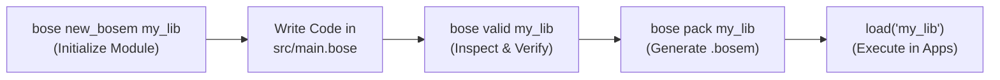

# Chapter 17: Module Packaging & Distribution (`.bosem`)

> **"One Folder, One File, Zero Dependencies, Tamper-Proof Execution."**

In BoseLang, you can easily bootstrap, package, and distribute any reusable library or folder into a single, compact, pre-compiled binary module called **`.bosem` (BoseLang Module)**.

---

## 1. Quick Workflow: 3 Simple Commands

BoseLang provides a complete, modern module development lifecycle:



---

### Step 1: Create a New Module (`bose new_bosem`)
Run `bose new_bosem` to generate a standard, production-ready module project structure:

```bash
bose new_bosem my_math
```

*(Aliases: `bose new my_math` or `bose create_bosem my_math`)*

**Output in terminal:**
```text
🚀 Creating new BoseLang module project 'my_math'...
  ✔ Created directory: my_math/
  ✔ Created bose.json (Module manifest & metadata)
  ✔ Created src/main.bose (Starter code with exported blocks)
  ✔ Created README.md (Documentation & packaging guide)
  ✔ Created LICENSE (MIT License)
  ✔ Created .gitignore

🎉 Successfully initialized module 'my_math'!

👉 Next steps:
   1. cd my_math
   2. Edit src/main.bose (write your logic)
   3. bose valid my_math
   4. bose pack my_math
```

#### Generated Project Directory Layout:
```text
my_math/
├── bose.json          # Module manifest (name, version, author, description, entry)
├── README.md          # Complete documentation & usage guide
├── LICENSE            # Open-source MIT license
├── .gitignore         # Ignores .bosem, .env
└── src/
    └── main.bose      # Entry point with starter exported blocks
```

---

### Step 2: Validate the Module (`bose valid`)
Before building or packing, run pre-flight validation to inspect file integrity, UTF-8 validity, syntax, and exported symbols:

```bash
bose valid my_math
```

**Output in terminal:**
```text
🔍 Inspecting 'my_math'...
  ✔ [1/3] File Integrity: Valid UTF-8 (File is readable & uncorrupted)
  ✔ [2/3] Syntax & Grammar: Passed (16 lines analyzed, 0 errors)
  ✔ [3/3] Exported Symbols: Found 3 [ greet, add, VERSION ]

🎉 All OK! Module is valid and ready to pack.
👉 Next Step: bose pack my_math
```

---

### Step 3: Pack into `.bosem` Binary (`bose pack`)
Pack your module folder into a single, compact, tamper-proof binary container:

```bash
bose pack my_math
```

**What happens automatically:**
1. **Auto-Validation:** Verifies file integrity, runs syntax & grammar checks, and ensures at least one exported symbol exists.
2. **Manifest Embedding:** Reads metadata from `bose.json` (author, version, description) and bakes it into the `.bosem` binary header.
3. **CRC32 Checksum:** Attaches IEEE 802.3 CRC32 checksum for tamper detection.
4. **Binary Generation:** Creates `my_math/my_math.bosem`.

**Output in terminal:**
```text
📦 Packaging module 'my_math'...
  ✔ [1/3] Validation: Passed (0 errors)
  ✔ [2/3] Manifest: Attached (Exports: [greet, add, VERSION])
  ✔ [3/3] Output File: my_math\my_math.bosem (605 bytes)

⚡ Success! Module packaged successfully.
👉 Usage: fix my_math = load("my_math\my_math.bosem")
```

---

## 2. Loading a `.bosem` Module in Any Project

You can load a `.bosem` module in any BoseLang application using the standard `load()` function:

### A. Load by Module Folder Path
```bose
fix math = load("my_math", greet, add, VERSION)

out("Version:", math.VERSION)
out(math.greet("Developer"))
out("10 + 20 =", math.add(10, 20))
```

### B. Load by Exact `.bosem` File Path
```bose
fix math = load("my_math/my_math.bosem", greet, add)

out(math.greet("World"))
out("5 * 6 =", math.add(5, 6))
```

---

## 3. Tamper Detection & Security Shields

Every `.bosem` file contains:
- **Magic Header:** `BOSEM\x01`
- **Embedded CRC32 Checksum:** Validates every byte of the payload.

If a `.bosem` file is edited in Notepad, tampered with, or corrupted during file transfer, BoseLang immediately halts execution with a fail-fast security alert:
```text
Security Error: Tampered or corrupted .bosem file detected.
  Expected CRC32: 0xD45A6117, Found: 0x839F290E
```
This protects your applications from executing corrupted or tampered external dependencies.
